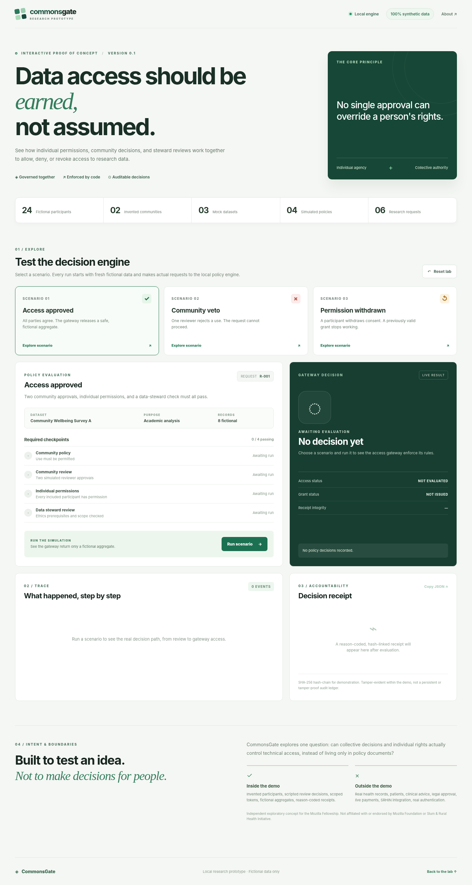

# CommonsGate — Community-governed AI data-access lab (v0.2)

**A working, dependency-free local proof of concept:** community governance and an individual's permission can prevent access to a fabricated research dataset. The local web interface runs three real API-driven scenarios: **allow**, **deny by community veto**, and **revoke after individual withdrawal**.

> **Exploratory software only.** No real patients, clinical records, public-health advice, Mozilla/SRHIN affiliation, legal validation, ethics approval, security certification, or production access management. All communities, participants, reviews, benefits and datasets are invented. Do not load real information or deploy publicly.



**Quick links:** [Reviewer guide](docs/REVIEWER_GUIDE.md) · [Two-minute demo](docs/DEMO_SCRIPT.md) · [Security limitations](SECURITY.md) · [Architecture](docs/ARCHITECTURE.md) · [Contributing](CONTRIBUTING.md)

## v0.2: governance validation kit (not yet field-validated)

Alongside the existing local allow / veto / revoke lab, version 0.2 adds a **review worksheet** at **http://127.0.0.1:4173/review.html**. A reviewer can run the fictional scenarios, answer structured comprehension/usability questions, and export a JSON file **on their own computer**. No feedback is posted to an API, retained in a database, or stored in browser storage.

- [Exploratory evaluation protocol](docs/validation/EVALUATION_PROTOCOL.md)
- [Facilitator guide](docs/validation/FACILITATOR_GUIDE.md)
- [Aggregate feedback template](docs/validation/FEEDBACK_SUMMARY_TEMPLATE.md)
- [Two-minute demo recording plan](docs/validation/TWO_MINUTE_DEMO.md)

**No external reviewers, real community participation, partnership endorsement, or video recording are claimed.** Facilitated community research must wait for appropriate consent, safeguards, partner involvement and approvals. Never publish raw feedback files or health information.

## Run it locally

Requirements: **Node.js 20 or newer**. No npm install, package download, cloud account, Docker or database required.

```bash
npm start
```

Open **http://127.0.0.1:4173** on the same computer. Select a scenario and click **Run scenario**. You can run a different scenario immediately; each run resets the fictional data.

To run the tests (22 automated checks in this release):

```bash
npm test
npm run check
```

To change the port, set `PORT` in your shell. The server deliberately binds to `127.0.0.1` only.

## What the three demonstrations actually do

| Scenario | Steps | Expected result |
|---|---|---|
| Allow | Two reviewer approvals, valid fictional permissions, steward approval, issue scoped 15-minute token, use gateway | `ACCESS_ALLOWED`; only a mock aggregate returned |
| Deny | One reviewer approves, one reviewer vetoes, steward approves, evaluate, access attempted without grant | `DENIED_COMMUNITY_VETO`; no token and gateway denies |
| Revoke | Approve and access successfully, fictional participant P-001 withdraws permission, reuse old token | Prior access succeeds, then `DENIED_GRANT_REVOKED` |

The engine also prevents wrong-role actions, access with expired tokens, changed request terms, prohibited uses and policy changes after grant issuance. It writes SHA-256 hash-linked receipts; these show accidental tampering within memory but do **not** provide durable or cryptographically tamper-proof storage.

## Demo composition

- 24 explicitly fictional participants across 2 invented communities.
- 3 fabricated dataset collections; 4 hypothetical policy definitions; 6 invented research requests.
- 2 illustrative benefit commitments; no money movement.
- Basic rule engine with 4 required gates: purpose policy, independent community review, participant-level permission and steward approval.
- API-enforced scoped grants; grant tokens stored as SHA-256 hashes and returned once, not in state endpoints.
- Browser UI, reason-coded decisions, trace log, receipt export, public non-identifying benefit summary.

## API (local demonstration only)

| Method | Route | Demo actor header |
|---|---|---|
| GET | `/api/health`, `/api/state`, `/api/public/benefits` | None |
| POST | `/api/demo/run` `{ "scenario": "allow" / "deny" / "revoke" }` | `demo-operator` |
| POST | `/api/demo/reset` | `demo-operator` |
| POST | `/api/requests/R-001/reviews` `{ "vote": "APPROVE" / "REJECT" }` | `river-reviewer-1` or `river-reviewer-2` |
| POST | `/api/requests/R-001/steward-check` `{ "ethicsStatus": "APPROVED" }` | `river-steward` |
| POST | `/api/requests/R-001/evaluate` | `researcher-1` |
| POST | `/api/access/authorize` `{ "requestId":"R-001", "grantToken":"..." }` | `researcher-1` |
| POST | `/api/consents/CN-D-001-P-001/withdraw` | `participant-P-001` |

`x-demo-actor` is **not real authentication**: the identifiers are intentionally public so the exercise is reproducible. No endpoint should be exposed to external networks or adapted to real data without implementing genuine identity, authorization, persistent and transactional data, secure logging, consent/legal modelling, abuse controls and security review.

**Example: directly call the real allow flow** (Node 20+):

```js
const base = 'http://127.0.0.1:4173';
const post = async (url, actor, data = {}) => (await fetch(base + url, {
  method: 'POST', headers: {'Content-Type':'application/json', 'x-demo-actor':actor},
  body: JSON.stringify(data)
})).json();
await post('/api/demo/reset', 'demo-operator');
await post('/api/requests/R-001/reviews', 'river-reviewer-1', {vote:'APPROVE'});
await post('/api/requests/R-001/reviews', 'river-reviewer-2', {vote:'APPROVE'});
await post('/api/requests/R-001/steward-check', 'river-steward', {ethicsStatus:'APPROVED'});
const decision = await post('/api/requests/R-001/evaluate', 'researcher-1');
console.log(decision.status);
console.log(await post('/api/access/authorize','researcher-1',{
  requestId:'R-001', grantToken:decision.grantToken
}));
```

## Architecture

```text
public/index.html + app.js + styles.css (browser UI)
            |
            v
        src/server.js (Node HTTP API)
            |
            v
        src/engine.js (policy checks + grant validation + receipts)
            |
            v
        src/fixtures.js (24 fictional participants; in-memory)
```

**Intentional divergence from the concept's future stack:** this first lab uses dependency-free Node.js and plain browser JavaScript rather than React, Fastify and PostgreSQL. That keeps it locally reproducible and focuses evaluation on the governance/permission logic. The future full prototype still calls for a proper TypeScript service, authenticated roles, PostgreSQL transactions, a shared policy model, a governed review process, and community-led validation.

## Known limitations and critical caveats

1. **Not real authentication:** `x-demo-actor` is spoofable; scripts can reset the lab and simulate approvals. Only safe on localhost with invented data.
2. **In-memory, single-process only:** actions have synchronous critical sections but do not establish cross-process concurrency safety, durable atomic revocation, or transactional audit storage.
3. **Mock reviews:** invented two-reviewer quorum and veto are for demonstrating decision paths. No community has approved these governance rules. Community approval cannot replace individual rights, lawful processing grounds, ethics review or regulator obligations.
4. **No real data-access connector:** the gateway releases invented aggregate counts, not protected records. Even genuine revocation can prevent only subsequent access; it cannot erase previously released copies or reverse training of an external AI model.
5. **No real benefit sharing:** benefits are fictional illustrative statuses. There are no financial transactions, ownership rights or verified contributions.
6. **No partner endorsement:** this is independently developed research and demonstration work, not a tool adopted, evaluated, or sanctioned by Mozilla Foundation or SRHIN.

## Next validation gates

1. Ask SRHIN which technical controls already exist in GENSCORE / Gencurate, and what specific unmet need it would find useful.
2. Verify community authority, representation, consent/legal bases, benefit sharing and actual user journeys with SRHIN and appropriately engaged participants.
3. Produce a threat model, security/privacy review and genuine authorization plan before any real-world pilot.
4. Move to React/TypeScript, Fastify and PostgreSQL only after the assumptions and prototype behaviour are validated.

## Sharing the work in the open

This repository is intended for public inspection, reproduction, feedback and improvement. Source code and governance examples are published under the included MIT license; all data and people depicted are invented. **The GitHub repository itself is the public artefact; the API must stay local-only.** See [SECURITY.md](SECURITY.md) before using any part of this outside a synthetic test.

## Licence

MIT (see [LICENSE](LICENSE)); do not assume this license applies to any Mozilla or SRHIN material.
